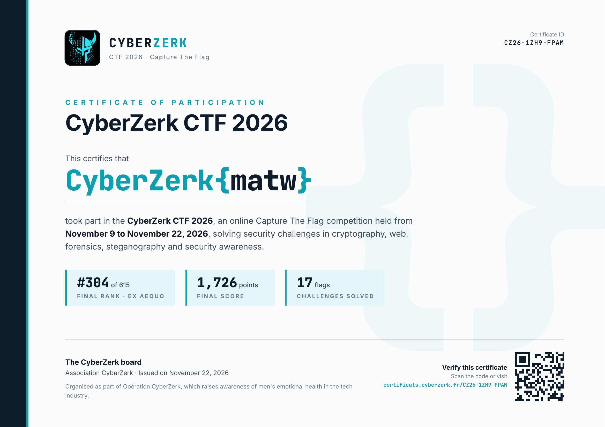

# CyberZerk CTF 2026

I participated in **CyberZerk CTF 2026**, an online Capture the Flag competition held from **9–22 November 2026**. The challenges covered web security, cryptography, digital forensics, steganography, and security awareness.

## Results

| Metric | Result |
| --- | --- |
| Username | `matw` |
| Final rank | **304 / 615** |
| Points | **1,726** |
| Flags solved | **17** |

## Reflection

I had less time to dedicate to this CTF than I would've liked due to coursework and preparation for the **Hack The Box CWES** certification. I still enjoyed taking part and gaining more hands-on experience across different security disciplines.

I'm looking forward to applying what I've learned and allocating more focused time to future competitions.

## Participation certificate

