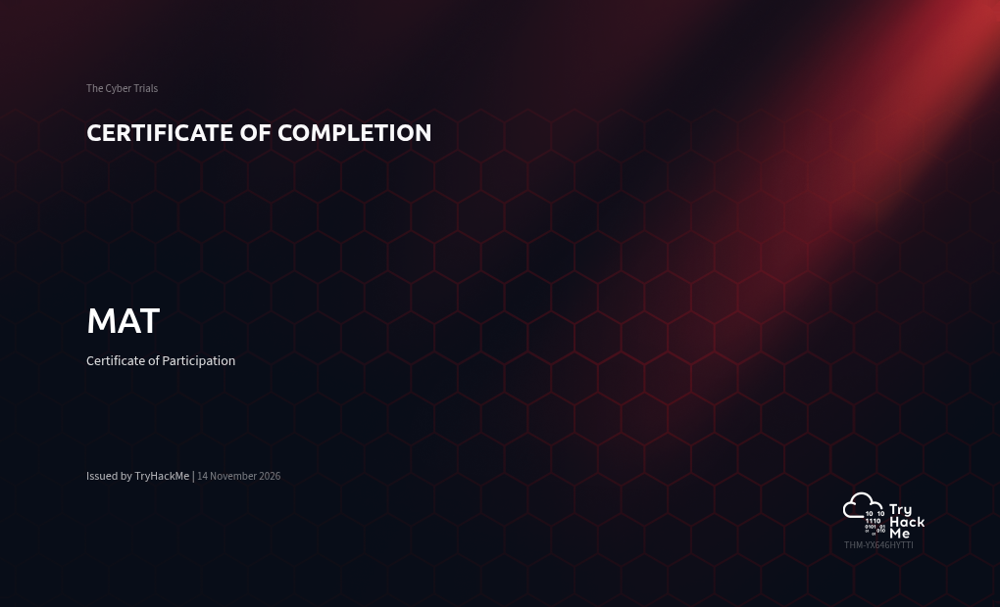

# CyberTrials 2026 — CTF Write-ups

## Overview
This directory documents my participation in **CyberTrials 2026**, a cybersecurity Capture The Flag (CTF) competition.
Unfortunately as The Cyber Trials 2026 has closed all its rooms, I am unable to accurately write a walkthrough of each successful room and challenges I managed to complete.

## Write-up Structure
Only once the challenges go public I will be able to publish writeups

## Purpose
These write-ups form part of my ongoing development in **penetration testing, web application security and offensive cybersecurity**, alongside my preparation for industry certifications and practical security assessments.

## Placed 18/27 Teams
- **Team name:** City St George's, Un
- **Participants during the CTF:** matw0
- **Challenges Solved:** 4/12
- **Score:** 810/1740

## Self Reflection
Cryptography, Forensics and Reverse engineering were by far my strongest, timing was a constraint, whenever I struggled with a challenge, rather than stepping away for a moment and give other challenges an opportunity, I stuck to the original challenge causing me to overspend a lot of time. I unfortunately was unable to even attempt the WEB sections in this CTF, which I'm sure I would've enjoyed since that's my strongest domain at the moment. This was my second CTF, I'm still adjusting, and for a CTF that involves more players I can't expect to attempt all challenges. Nevertheless, I enjoyed this learning experience, polishing up on my reverse engineering skills felt refreshing. I am looking forward to pursue more CTFs shortly!

## Proof Of Participation

